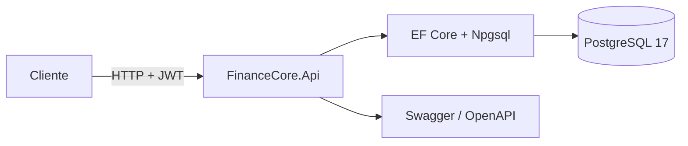

# FinanceCore — API de transações financeiras

> **Status: implementação concluída.** Etapas 1 a 7 concluídas: modelagem, autenticação
> JWT, endpoints, transferências transacionais, concorrência, idempotência, testes
> automatizados e CI. Limitações conhecidas estão listadas abaixo.

## Objetivo

Construir uma API REST para simular contas financeiras, permitindo consultar saldos, registrar movimentações e transferir valores entre contas. **Não integrar com bancos ou meios de pagamento reais.**

## Stack

- C# e ASP.NET Core Web API
- .NET 10 (LTS) — SDK utilizado: `10.0.403`
- PostgreSQL 17 (container Docker)
- Entity Framework Core 10 + Npgsql
- JWT (HS256) para autenticação
- Swagger/OpenAPI (Swashbuckle)
- xUnit para testes (unitários e de integração)
- Testcontainers para testes de integração com PostgreSQL real
- GitHub Actions para CI
- Docker Compose para ambiente local

## Arquitetura



## Endpoints

| Método | Rota | Autenticação | Descrição |
| --- | --- | --- | --- |
| POST | `/api/auth/register` | Não | Cria usuário e retorna token JWT |
| POST | `/api/auth/login` | Não | Autentica e retorna token JWT |
| POST | `/api/accounts` | Sim | Cria uma conta para o usuário autenticado |
| GET | `/api/accounts` | Sim | Lista as contas do usuário autenticado |
| GET | `/api/accounts/{accountId}` | Sim | Consulta saldo e dados de uma conta própria |
| GET | `/api/accounts/{accountId}/movements` | Sim | Histórico paginado (`page`, `pageSize`) |
| POST | `/api/accounts/{accountId}/deposits` | Sim | Depósito simulado com `Idempotency-Key` |
| POST | `/api/transfers` | Sim | Transferência com `Idempotency-Key` |
| GET | `/health` | Não | Health check da API e do banco |

Respostas de erro usam `ProblemDetails`. Códigos relevantes: `400` validação,
`401` sem token/credenciais inválidas, `404` conta não encontrada ou de outro usuário,
`409` idempotência/concorrência, `422` saldo insuficiente ou limite excedido.

## Escopo funcional

- [x] Criar e consultar contas de usuários autenticados.
- [x] Consultar saldo e histórico de movimentações.
- [x] Registrar depósitos simulados.
- [x] Transferir valores entre duas contas.
- [x] Impedir transferências com valor inválido, saldo insuficiente ou conta inexistente.
- [x] Restringir cada usuário às contas e operações que tem permissão para acessar.

## Modelo de dados

- `users`: usuário, com e-mail único e senha armazenada como hash PBKDF2.
- `accounts`: conta pertencente a um usuário, com `balance` em `NUMERIC(18,2)`.
- `operations`: operação de depósito ou transferência, com chave de idempotência única por usuário.
- `movements`: histórico imutável de cada lançamento em uma conta, com valor com sinal e saldo após a operação.

Invariantes garantidas no banco:

- `accounts.balance >= 0` (check constraint).
- `operations.amount > 0` e estrutura coerente por tipo (depósito/transferência).
- `(initiated_by_user_id, idempotency_key)` único.
- `movements.amount <> 0`, `movements.balance_after >= 0` e um lançamento por operação/conta.
- Conta possui token de concorrência otimista `xmin` do PostgreSQL (propriedade `uint Version` via `IsRowVersion`).

## Regras de negócio e segurança

- Senhas usadas somente para gerar hash com `PasswordHasher<User>` (PBKDF2); nunca são persistidas em texto puro.
- JWT com expiração de 60 minutos e chave HMAC configurada fora do repositório.
- Toda consulta/operação de conta é filtrada pelo usuário autenticado; contas de outros usuários retornam `404`.
- Depósitos e transferências exigem o cabeçalho `Idempotency-Key` (até 100 caracteres), único por usuário.
- Repetir a mesma operação com a mesma chave e mesmos parâmetros retorna `200` com a operação original; reutilizar a chave com parâmetros diferentes retorna `409`.
- Transferência e depósito executam dentro de uma transação de banco. Transferências debitam e creditam na mesma transação.
- O saldo é protegido por concorrência otimista (`xmin`) e pela restrição `balance >= 0`; conflitos retornam `409`.
- Valores usam `decimal` no C# e `NUMERIC(18,2)` no PostgreSQL.

## Pré-requisitos

- .NET SDK 10
- Docker com Docker Compose (necessário também para os testes de integração)

## Como executar localmente

1. Restaure as ferramentas locais:

   ```bash
   dotnet tool restore
   ```

2. Crie o arquivo de ambiente e defina a senha do PostgreSQL:

   ```bash
   cp .env.example .env
   # Edite POSTGRES_PASSWORD no .env
   ```

   Em PowerShell: `Copy-Item .env.example .env` e depois edite o arquivo.

   O container usa a porta **5433** por padrão para não conflitar com instalações
   locais do PostgreSQL. Ajuste `POSTGRES_PORT` no `.env` se necessário.

3. Suba o banco:

   ```bash
   docker compose up -d --wait
   ```

4. Configure os segredos fora do repositório (User Secrets):

   ```bash
   dotnet user-secrets --project src/FinanceCore.Api set "ConnectionStrings:Default" \
     "Host=localhost;Port=5433;Database=financecore;Username=financecore;Password=<senha-do-.env>"

   dotnet user-secrets --project src/FinanceCore.Api set "Jwt:SigningKey" \
     "<chave-aleatoria-com-pelo-menos-32-bytes>"
   ```

   Alternativa para ambientes sem User Secrets: definir as variáveis
   `ConnectionStrings__Default` e `Jwt__SigningKey`.

5. Aplique as migrations:

   ```bash
   dotnet ef database update --project src/FinanceCore.Api
   ```

6. Execute a API:

   ```bash
   dotnet run --project src/FinanceCore.Api
   ```

7. Verifique:

   - Swagger UI: <http://localhost:5005/swagger>
   - Health check (inclui conexão com o banco): <http://localhost:5005/health>

Comandos canônicos:

```bash
dotnet restore
dotnet build
dotnet test
docker compose up -d
```

## Exemplo de uso

1. Crie o usuário e copie o `accessToken`:

   ```bash
   curl -X POST http://localhost:5005/api/auth/register \
     -H "Content-Type: application/json" \
     -d '{"name":"Alice","email":"alice@example.com","password":"SenhaForte123!"}'
   ```

2. Crie uma conta usando o token:

   ```bash
   curl -X POST http://localhost:5005/api/accounts \
     -H "Authorization: Bearer <token>"
   ```

3. Registre um depósito com chave de idempotência:

   ```bash
   curl -X POST http://localhost:5005/api/accounts/<accountId>/deposits \
     -H "Authorization: Bearer <token>" \
     -H "Idempotency-Key: deposito-001" \
     -H "Content-Type: application/json" \
     -d '{"amount":100.00}'
   ```

4. Transfira para outra conta:

   ```bash
   curl -X POST http://localhost:5005/api/transfers \
     -H "Authorization: Bearer <token>" \
     -H "Idempotency-Key: transferencia-001" \
     -H "Content-Type: application/json" \
     -d '{"sourceAccountId":"<origem>","destinationAccountId":"<destino>","amount":30.00}'
   ```

O arquivo `src/FinanceCore.Api/FinanceCore.Api.http` contém requisições prontas
para Swagger/VS Code/Rider.

## Estrutura do repositório

```text
FinanceCore.slnx
compose.yaml
.env.example
src/FinanceCore.Api/
  Common/                 # extensões, dinheiro, idempotência e erros do PostgreSQL
  Data/                   # DbContext, factory de design-time e configurações EF
  Data/Migrations/        # Migrations
  Domain/                 # User, Account, Operation, Movement
  Features/Auth/          # registro, login, JWT
  Features/Accounts/      # contas e histórico
  Features/Operations/    # depósitos e transferências
tests/FinanceCore.UnitTests/       # regras de valor e idempotência
tests/FinanceCore.IntegrationTests/ # API completa com Testcontainers
.github/workflows/ci.yml           # build + testes no GitHub Actions
```

## Diferenciais técnicos

- [x] Valores monetários com `decimal` no C# e `NUMERIC(18,2)` no PostgreSQL.
- [x] Movimentações persistidas como histórico (`operations` + `movements`).
- [x] Restrição no banco para impedir saldo negativo.
- [x] Débito e crédito na mesma transação do banco.
- [x] Proteção do saldo contra concorrência com concorrência otimista (`xmin`).
- [x] Chave de idempotência nas operações sujeitas a repetição.
- [x] Autenticação e autorização por recurso.

## Testes

A suíte completa (47 testes: 18 unitários + 29 de integração) executa com um único comando:

```bash
dotnet test
```

- **Testes unitários** (`tests/FinanceCore.UnitTests`): regras de valor monetário
  (limites, escala, sinal) e normalização de chaves de idempotência.
- **Testes de integração** (`tests/FinanceCore.IntegrationTests`): sobem um PostgreSQL 17
  efêmero via Testcontainers, aplicam as migrations e exercitam a API por HTTP.
- Cada teste limpa o banco antes de executar; não há dependência de dados pré-existentes.
- **Concorrência real**: 20 transferências simultâneas, transferências em direções opostas,
  múltiplos depósitos/transferências simultâneos com a mesma chave e tentativas simultâneas
  de saque. Os testes validam que não há saldo negativo, operação duplicada nem resposta 500.
- **Idempotência sob corrida**: replays concorrentes com a mesma chave retornam a mesma
  operação; chaves são isoladas por usuário e reutilizá-las com outro tipo/parâmetros retorna `409`.
- **Invariantes do ledger**: o saldo de cada conta é comparado com a soma das movimentações,
  e as contagens de operações/movimentações são verificadas diretamente no banco.
- **Segurança**: senha persistida como hash PBKDF2 e ausente da resposta; tokens adulterados
  ou malformados retornam `401`; usuários não acessam contas de terceiros.
- **Validações**: cadastro inválido, valor máximo e acima do máximo, contas inexistentes,
  transferência para a mesma conta e paginação inválida.
- **Estabilidade**: a suíte foi executada repetidamente em Release (3 execuções completas e
  5 execuções do subconjunto de concorrência/idempotência) sem falhas intermitentes.
- O workflow `.github/workflows/ci.yml` executa restore, build e a suíte completa em
  pushes e pull requests, publicando a cobertura (Cobertura) como artifact.
- Para gerar cobertura localmente: `dotnet test --collect:"XPlat Code Coverage"`.

Testes essenciais cobertos:

- [x] Transferência válida altera os dois saldos corretamente.
- [x] Saldo insuficiente não altera nenhuma conta.
- [x] Falha no crédito não deixa o débito efetivado.
- [x] Repetir uma requisição com a mesma chave de idempotência não duplica a operação.
- [x] Duas tentativas simultâneas de saque não produzem saldo negativo.
- [x] Usuário não acessa contas de outro usuário.

## Etapas de implementação

1. [x] Criar solução, API, configuração do PostgreSQL e migrations.
2. [x] Modelar usuários, contas e movimentações.
3. [x] Implementar endpoints e validações básicas.
4. [x] Adicionar autenticação e autorização.
5. [x] Implementar transferências transacionais e proteção contra concorrência.
6. [x] Escrever testes unitários e de integração, incluindo cenários simultâneos.
7. [x] Adicionar CI e concluir a documentação de execução.

## Decisões técnicas

- **Operação + movimentações**: `operations` registra a intenção (depósito/transferência)
  e `movements` registra cada lançamento no histórico. Uma transferência gera dois
  lançamentos ligados à mesma operação.
- **Idempotência por usuário**: a chave fica em `operations` com índice único
  `(initiated_by_user_id, idempotency_key)`, impedindo duplicação e evitando colisão
  entre usuários. Replays retornam a operação original; parâmetros divergentes geram `409`.
- **Concorrência**: `accounts` usa `xmin` como token de concorrência otimista em
  transações explícitas. Se duas operações disputam a mesma conta, uma delas falha com
  `409` e o banco impede saldo negativo.
- **Atomicidade**: depósitos e transferências usam transação explícita e rollback em
  qualquer falha; débito e crédito são persistidos juntos.
- **Dinheiro**: `NUMERIC(18,2)` no banco e `decimal` no domínio, nunca `float`/`double`.
- **Autenticação**: JWT HS256 com emissor/audiência configurados e chave de assinatura
  apenas via User Secrets ou variável de ambiente.
- **Porta 5433**: escolhida para o container local evitar conflito com PostgreSQL nativo.
- **Segredos**: connection string e chave JWT via User Secrets/variáveis de ambiente;
  `.env` é ignorado pelo Git e `.env.example` contém apenas placeholders.

## Limitações conhecidas

- Sem refresh token, revogação de tokens, recuperação de senha ou exclusão de conta.
- Sem rate limiting ou bloqueio por tentativas de login.
- Conflitos entre operações diferentes na mesma conta não são repetidos automaticamente;
  o cliente recebe `409` (ou `422` se o saldo ficou insuficiente).
- Chaves de idempotência não expiram e ficam armazenadas junto às operações.
- Sem dados de demonstração/seed e sem paginação com total de registros.
- Os testes de integração exigem Docker em execução.

## Concluído quando

A aplicação executa localmente a partir das instruções do README, os testes passam e os testes de integração comprovam que transferências concorrentes não deixam o saldo inconsistente.

## Checklist de entrega

- [x] README claro com objetivo, funcionalidades, stack e pré-requisitos.
- [x] Diagrama simples de arquitetura e fluxo principal.
- [x] Instruções para executar localmente com comandos testados.
- [x] `.env.example` sem segredos reais, quando necessário.
- [x] Migrations e dados de demonstração, se úteis.
- [x] Testes automatizados executáveis por um único comando.
- [x] Pipeline de CI que compila e roda os testes.
- [x] Exemplos de requisições/respostas ou coleção do Postman/Bruno.
- [x] Decisões técnicas explicadas e limitações conhecidas registradas.
- [x] Pelo menos um cenário de falha documentado e coberto por teste.
